# FoodQueue

**ระบบสั่งอาหารผ่าน QR สำหรับร้านชาบู / บุฟเฟ่ต์ร้านเดียว** — ลูกค้าสแกน QR ที่โต๊ะแล้วสั่งอาหารจากมือถือ ครัวเห็นออเดอร์ทันที เจ้าของร้านดูแลโต๊ะ เมนู บิล การชำระเงิน และรายงานได้จากจอเดียว

UI ภาษาไทยทั้งหมด mobile-first สไตล์ Modern Minimal (ขาวสะอาด + ส้ม) รันในเครื่องได้ด้วย `docker compose` คำสั่งเดียว

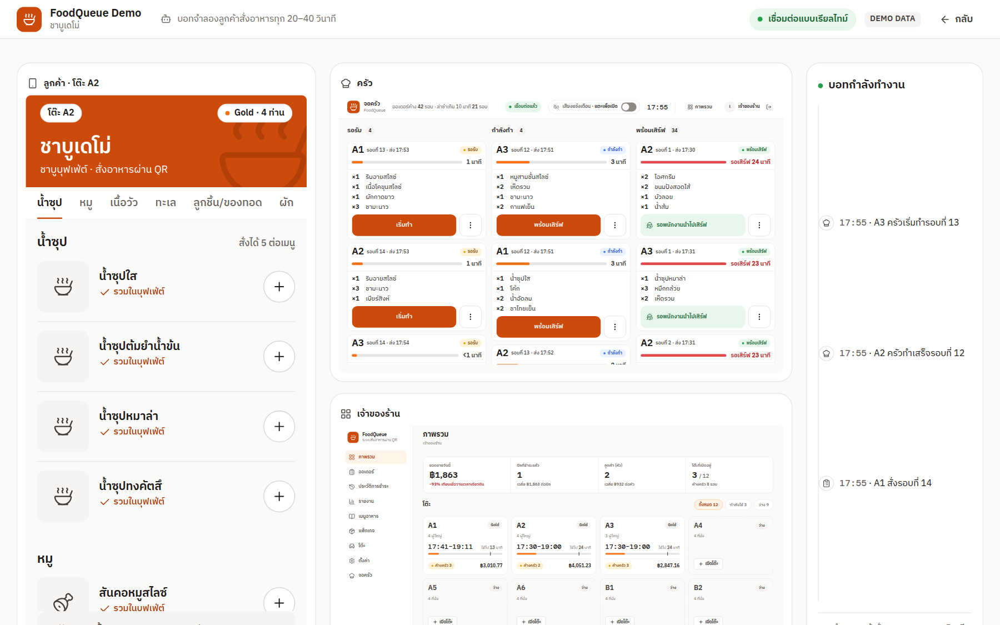

---

## สารบัญ

- [ภาพรวม](#ภาพรวม)
- [ฟีเจอร์](#ฟีเจอร์)
- [หน้าจอ](#หน้าจอ)
- [สถาปัตยกรรม](#สถาปัตยกรรม)
- [เริ่มใช้งาน](#เริ่มใช้งาน)
- [โหมด Demo](#โหมด-demo)
- [การพัฒนา](#การพัฒนา)
- [การทดสอบ](#การทดสอบ)
- [โครงสร้างโปรเจกต์](#โครงสร้างโปรเจกต์)
- [เอกสาร](#เอกสาร)
- [ข้อจำกัดและหมายเหตุ](#ข้อจำกัดและหมายเหตุ)

---

## ภาพรวม

ร้านชาบู/บุฟเฟ่ต์ขนาดเล็ก–กลางมักรับออเดอร์ด้วยกระดาษ ทำให้ออเดอร์ตกหล่น ครัวไม่รู้ว่าอะไรค้าง และตอนปิดบิลต้องรวมค่าบุฟเฟ่ต์กับเครื่องดื่มเอง FoodQueue แทนที่ทั้งวงจรนั้นด้วยระบบเดียว:

| บทบาท | อุปกรณ์ | สิ่งที่ทำได้ |
|---|---|---|
| **ลูกค้า** | มือถือ (สแกน QR) | ดูเมนูตามแพ็กเกจ สั่งเป็นรอบ ๆ ภายใต้ลิมิต เห็นรายการรวมของโต๊ะแบบ real-time ไม่ต้องสมัครสมาชิก |
| **ครัว** | แท็บเล็ตแนวนอน | เห็นออเดอร์ใหม่ทันที เลื่อนสถานะ `เริ่มทำ → พร้อมเสิร์ฟ` ด้วยปุ่มใหญ่ ปิดเสียงได้ |
| **เจ้าของร้าน** | เดสก์ท็อป / มือถือ | เปิดโต๊ะ–ออก QR, จัดการเมนู/แพ็กเกจ/โต๊ะ, แก้–ยกเลิกออเดอร์, ปรับยอด, รับชำระ, พิมพ์เอกสาร, ดูรายงาน |
| **ผู้ชม (Demo)** | เบราว์เซอร์ | กดปุ่มเดียวเข้าใช้ทุกบทบาท มีข้อมูลตัวอย่าง 30 วัน และบอทจำลองลูกค้าสั่งอาหารเอง |

จุดที่ออกแบบมาเพื่องานจริงในร้าน:

- **QR ผูกกับรอบการนั่ง ไม่ใช่โต๊ะ** — QR ใช้ได้จนกว่าจะปิดบิล และตายทันทีที่ชำระเงิน (ดู [`docs/adr/0001-session-scoped-qr.md`](docs/adr/0001-session-scoped-qr.md))
- **เวลาตัดสินจากนาฬิกาของร้าน** — มือถือลูกค้าตั้งเวลาเพี้ยนก็ไม่ทำให้ออเดอร์ถูกปฏิเสธผิด
- **บิลอธิบายได้ทุกบาท** — ค่าบุฟเฟ่ต์ผู้ใหญ่/เด็ก, เมนูคิดเงินแยก, รายการปรับยอด, ค่าบริการ, VAT แยกบรรทัด
- **ครัวกดซ้ำไม่ได้** — สองเครื่องกดพร้อมกันมีผลครั้งเดียว

---

## ฟีเจอร์

### ลูกค้า (มือถือ)
- เปิดจาก QR ของโต๊ะ เห็นชื่อโต๊ะและแพ็กเกจบนแบนเนอร์ร้านทันที
- เมนูกรองตามระดับแพ็กเกจ พร้อมป้าย **รวมในบุฟเฟ่ต์** หรือราคาเต็มสำหรับเมนูคิดเงินแยก
- เพิ่ม/ลดด้วยปุ่ม `+ −` ขนาด 44px, หมายเหตุต่อรายการ, ตะกร้าแยกกันในแต่ละมือถือ
- ลิมิตต่อเมนูและต่อรอบแสดงก่อนกดส่ง, ประกาศ **Last order** และปิดการสั่งเมื่อหมดเวลา
- หน้า **ออเดอร์ของโต๊ะ** รวมทุกรายการที่โต๊ะสั่ง อัปเดตเองแบบ real-time (ไม่แสดงสถานะหรือยอดเงิน)
- หน้า **ขอบคุณที่ใช้บริการ** เมื่อปิดบิล — QR เดิมใช้ต่อไม่ได้

### ครัว
- บอร์ด 3 คอลัมน์: **รอรับ / กำลังทำ / พร้อมเสิร์ฟ**, การ์ดใหม่ไฮไลต์พร้อมเสียงแจ้งเตือน
- เวลารอในแต่ละการ์ด และเตือนเมื่อเกิน 10 นาที
- หมายเหตุลูกค้าเน้นให้เห็นบนการ์ด, ระบุเหตุผลเมื่อยกเลิกออเดอร์
- แสดงสถานะการเชื่อมต่อ — เน็ตหลุดแล้วกลับมาเชื่อมเอง

### เจ้าของร้าน
- **ภาพรวม**: KPI วันนี้ (ยอดขาย บิล จำนวนลูกค้า) + ผังโต๊ะสองสถานะ (ใช้งานอยู่ / ว่าง)
- **โต๊ะ**: เปิดโต๊ะด้วยแพ็กเกจและจำนวนผู้ใหญ่/เด็ก, พิมพ์ QR slip 80 มม., ย้ายโต๊ะ, รวมบิล
- **ออเดอร์**: กรองตามสถานะ, แก้ไขจำนวน/นำรายการออกพร้อมเหตุผล, ยกเลิกทั้งรอบ, ป๊อปอัป+เสียงเมื่อมีออเดอร์ใหม่
- **ชำระเงิน**: เงินสด (คำนวณเงินทอน), PromptPay QR ตามยอดบิล, บัตร — ใบเสร็จเลขรันต่อเนื่อง
- **พิมพ์**: ใบแจ้งยอด (pre-bill), QR slip, ใบเสร็จ บนกระดาษความร้อน 80 มม. ผ่าน print dialog ของเบราว์เซอร์
- **รายงาน**: วันนี้ / 7 วัน / 30 วัน — ยอดขายรายวัน–รายชั่วโมง, สัดส่วนแพ็กเกจ, Top 10 เมนู, สัดส่วนวิธีจ่าย
- **ข้อมูลหลัก**: เมนู (บุฟเฟ่ต์/คิดเงินแยก + รูป), แพ็กเกจหลายระดับ (rank), หมวดหมู่, ตั้งค่าร้าน, บริการ/VAT, ลิมิตการสั่ง

### Demo Mode
- ข้อมูลตัวอย่างแบบกำหนดซ้ำได้: ร้าน "ชาบูเดโม่", 12 โต๊ะ, 3 แพ็กเกจ, 44 เมนู 8 หมวด, ประวัติ 30 วัน
- ปุ่มเข้าใช้ทันทีเป็นเจ้าของร้าน / ครัว (ไม่ต้องพิมพ์รหัส) และปุ่มเปิดมุมมองลูกค้าของโต๊ะจริง
- **Demo Bot** จำลองลูกค้าเปิดโต๊ะ–สั่ง–จ่ายเองทุก 20–40 วินาที (ไม่แตะโต๊ะที่คนจริงเปิด)
- หน้า `/demo` แสดงลูกค้า / ครัว / เจ้าของร้าน เคียงกันแบบ live
- ปิดทั้งโหมดได้ด้วย config เดียว แล้ว endpoint ของ demo ตอบ `404`

---

## หน้าจอ

### ลูกค้า — สแกน QR แล้วสั่งจากมือถือ

| เมนู | ตะกร้า | ออเดอร์ของโต๊ะ |
|---|---|---|
| 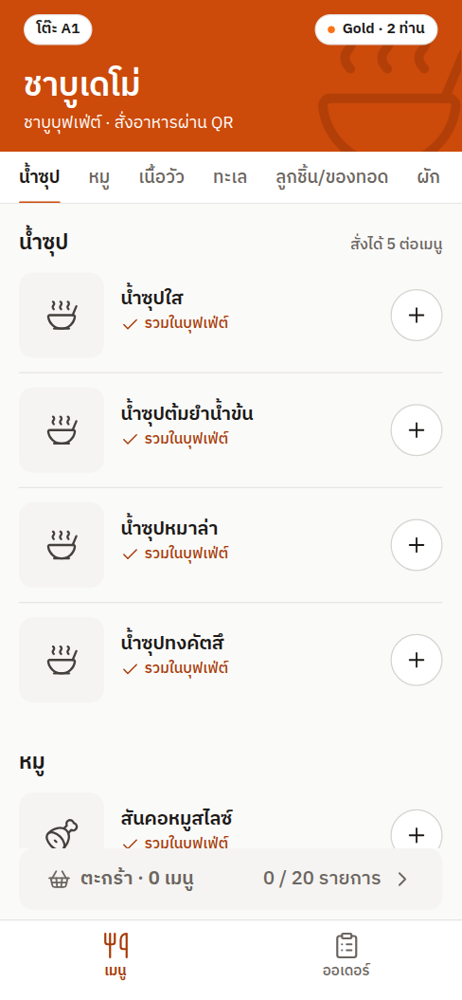 | 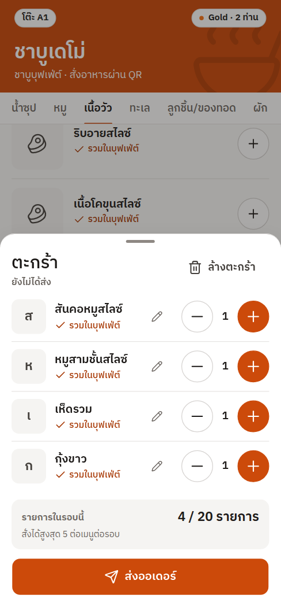 | 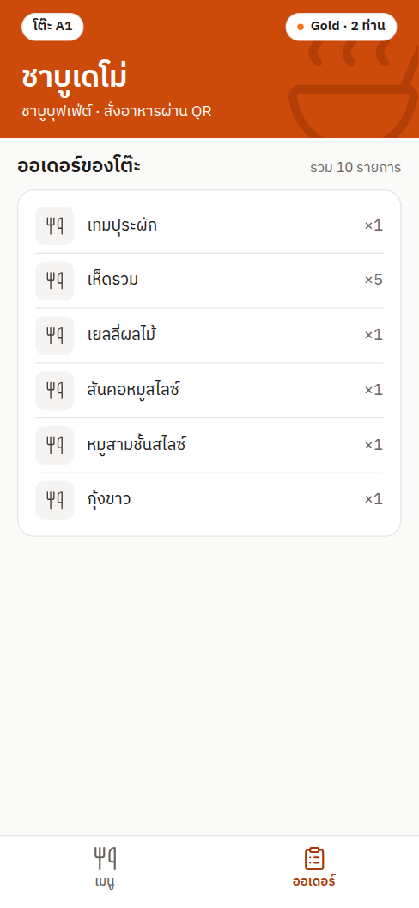 |

### ครัว — บอร์ด real-time บนแท็บเล็ตแนวนอน

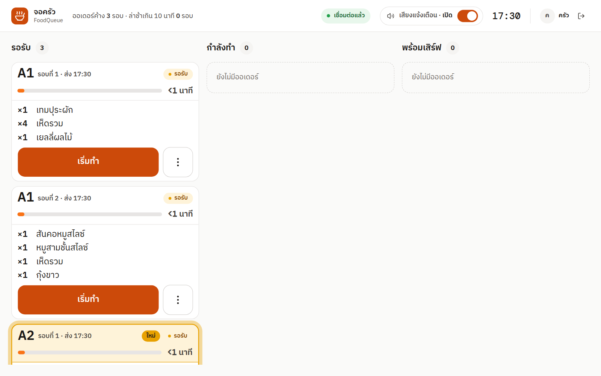

### เจ้าของร้าน

| ภาพรวม | ผังโต๊ะ | ออเดอร์ |
|---|---|---|
| 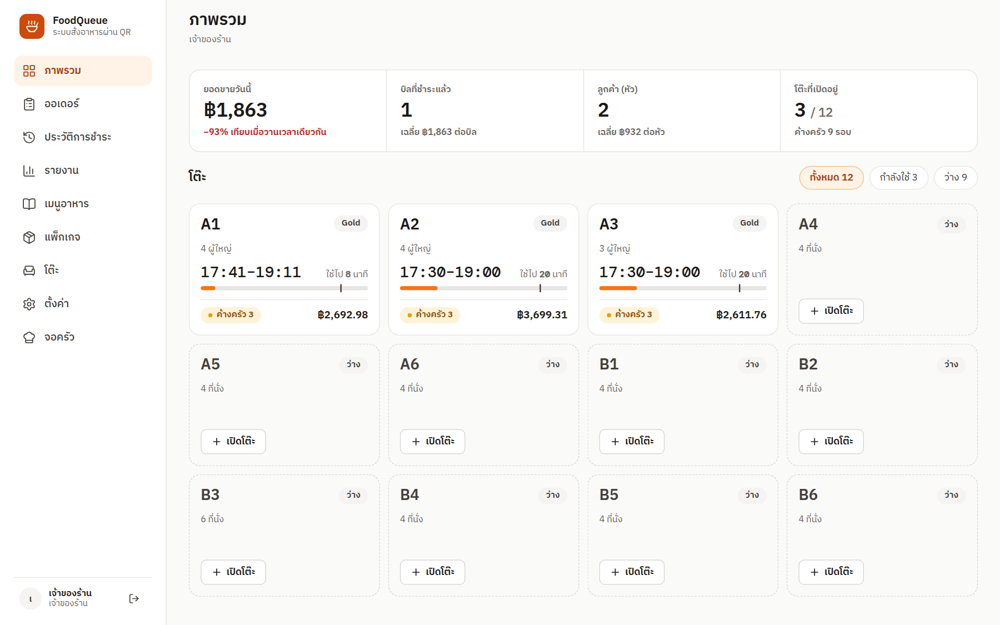 | 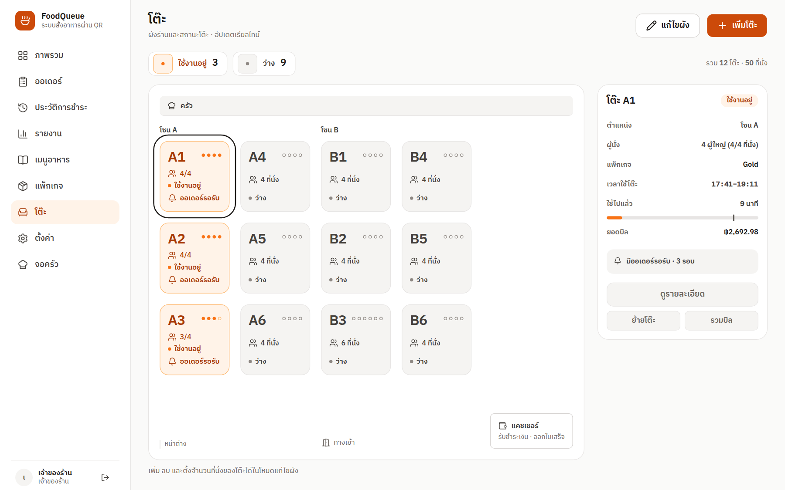 | 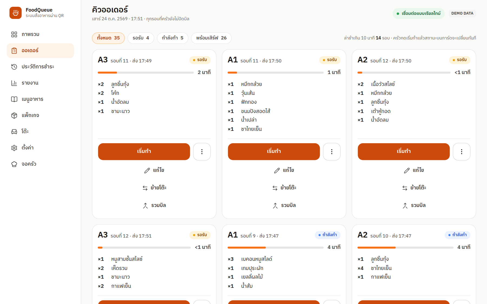 |

| รายงาน | ประวัติการชำระ | เมนูอาหาร |
|---|---|---|
| 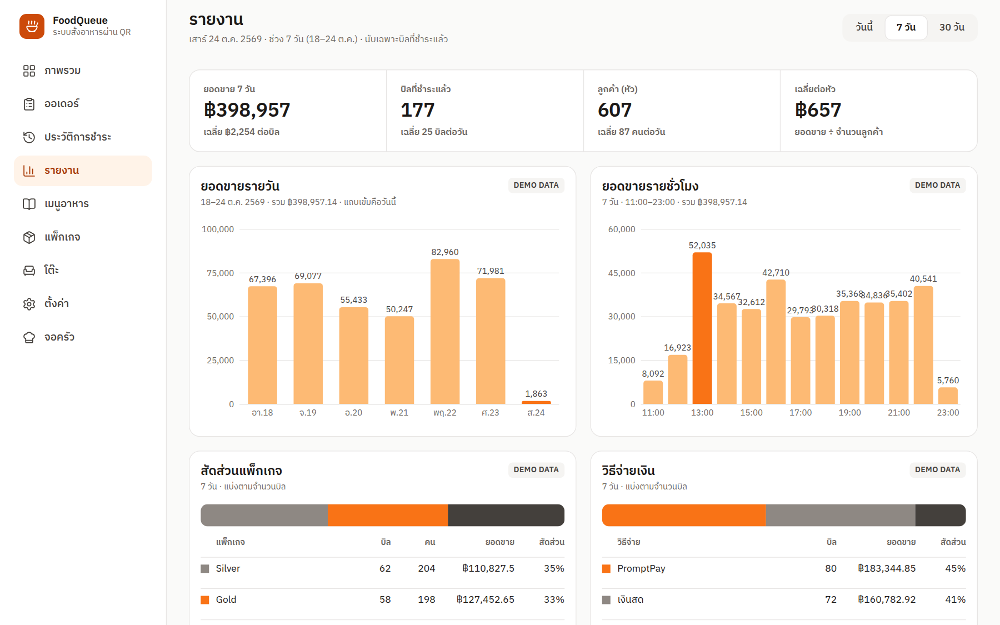 | 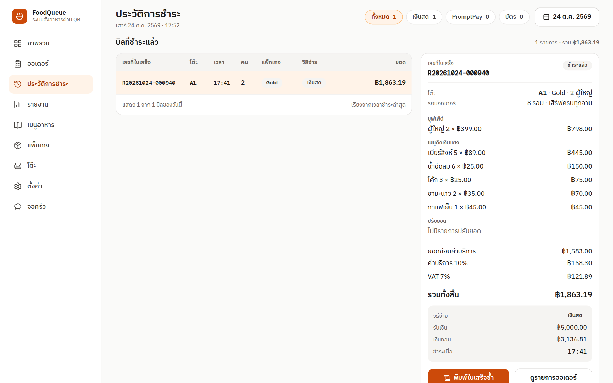 | 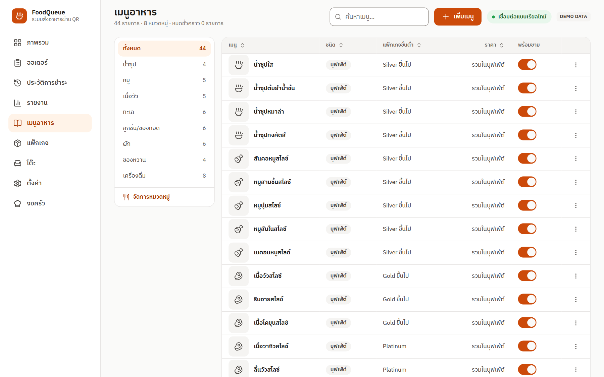 |

### เอกสารพิมพ์ 80 มม.

| QR slip | ใบแจ้งยอด | ใบเสร็จ |
|---|---|---|
| 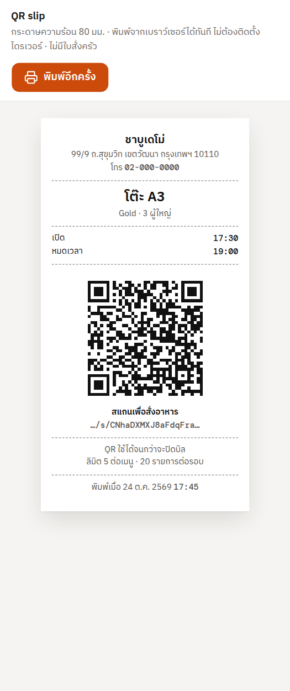 | 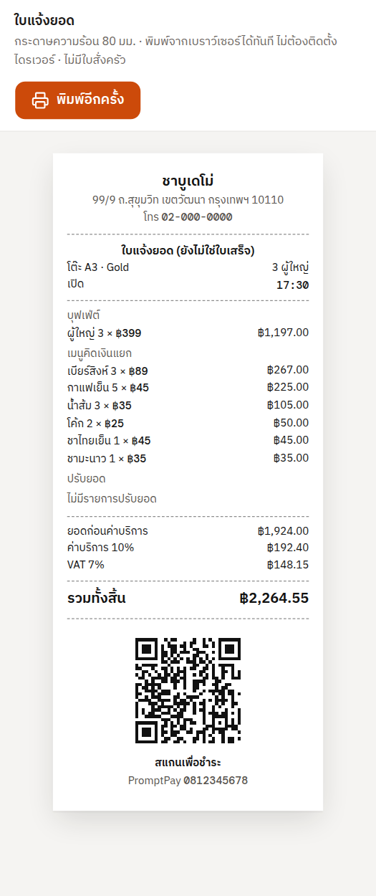 | 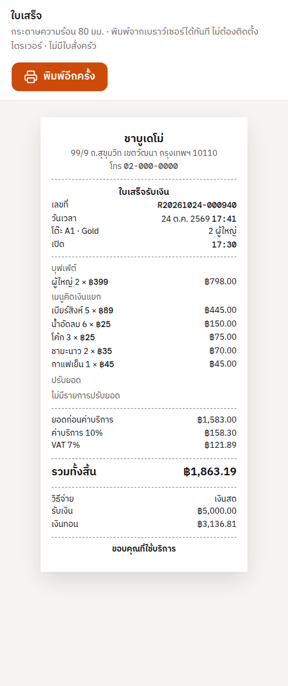 |

ภาพทั้งหมดถ่ายจากระบบที่รันจริงบนเครื่องนี้ (`docker compose` + Demo Mode) ไม่ใช่ภาพ mockup — ชุด mockup ต้นแบบอยู่ใน [`design/src/frames/`](design/src/frames) และเรนเดอร์เป็น PNG ได้ด้วย `node design/build.mjs` (ผลลัพธ์อยู่ที่ `design/out/` ซึ่งไม่ถูก commit)

---

## สถาปัตยกรรม

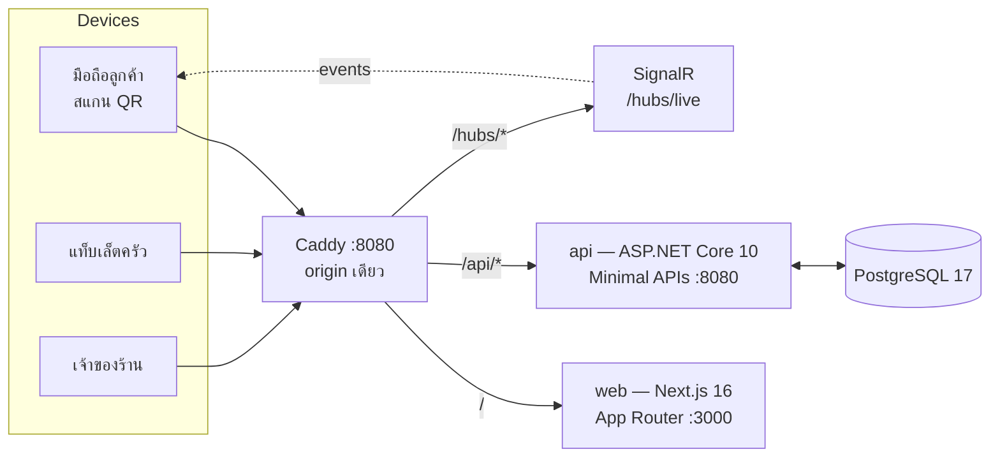

- **Single origin**: ทุกอย่างอยู่หลัง Caddy ที่ `http://localhost:8080` — cookie auth และ WebSocket ของ SignalR จึงทำงานได้โดยไม่ต้องมี CORS หรือ proxy WebSocket ใน Next (ดู [`docs/adr/0002-single-origin-caddy.md`](docs/adr/0002-single-origin-caddy.md))
- **Backend**: modular monolith แบบ vertical slice ตามฟีเจอร์ (`Auth`, `Tables`, `Packages`, `Menu`, `Sessions`, `Orders`, `Reports`, `Settings`, `Demo`, `Customer`) — Minimal APIs, โปรเจกต์เดียว + โปรเจกต์ทดสอบเดียว, ไม่มี MediatR
- **Realtime**: SignalR hub เดียว (`/hubs/live`) แยก group ตามผู้รับ — ลูกค้าเห็นเฉพาะรอบของตัวเอง, ครัวเห็นงานครัว, เจ้าของร้านเห็นทั้งสองฝั่ง
- **Database**: PostgreSQL + EF Core, migration ตัวเดียวชื่อ `Initial` ที่ apply เองตอน API สตาร์ท, เงินเป็น `decimal(10,2)`, เวลาเก็บเป็น UTC

| ชั้น | เทคโนโลยี |
|---|---|
| Frontend | Next.js 16.4 (App Router) · React 19 · TypeScript · Tailwind v4 · shadcn/ui · TanStack Query · Recharts · `@microsoft/signalr` · IBM Plex Sans Thai + DM Mono |
| Backend | ASP.NET Core 10 · Minimal APIs · EF Core 10 · ASP.NET Identity (cookie) · SignalR |
| Database | PostgreSQL 17 |
| Reverse proxy | Caddy 2 (TLS อัตโนมัติเมื่อตั้งโดเมน) |
| Tests | xUnit + Testcontainers (Postgres จริง) · Playwright (desktop + mobile 390×844) |

---

## เริ่มใช้งาน

ต้องมี **Docker** และ **Docker Compose** เท่านั้น (ไม่ต้องลง .NET หรือ Node บนเครื่อง)

```bash
cp .env.example .env
docker compose up --build -d
```

รอจนทุก service ขึ้น `healthy/running`:

```bash
docker compose ps
```

แล้วเปิด **<http://localhost:8080>** — ตรวจว่า API ต่อฐานข้อมูลได้ที่ **<http://localhost:8080/api/health>** ต้องได้ `{"status":"ok"}`

> เปิดผ่านพอร์ต **8080 ของ Caddy** เสมอ อย่าเปิด `:3000` ของ Next โดยตรง — cookie auth และ WebSocket พึ่งความ same-origin

หยุดระบบ: `docker compose down` — ล้างข้อมูลทั้งหมด (รวมประวัติ demo): `docker compose down -v`

### สแกน QR ด้วยมือถือจริงในวง LAN

ค่าเริ่มต้น `PUBLIC_BASE_URL=http://localhost:8080` มือถือสแกนแล้วเปิดไม่ได้ ให้ตั้งเป็น IP ของเครื่องที่รันระบบ:

```bash
PUBLIC_BASE_URL=http://192.168.1.20:8080 docker compose up -d
```

ค่านี้ถูกใช้สร้างลิงก์ `/s/<token>` ใน QR ทุกอัน — แก้แล้วต้องรัน compose ใหม่

### ตัวแปรสภาพแวดล้อม

| ตัวแปร | ค่าเริ่มต้น | ความหมาย |
|---|---|---|
| `DEMO_ENABLED` | `true` | เปิด Demo Mode (seed, บอท, ปุ่มเข้าใช้) — ปิดแล้ว endpoint ของ demo ตอบ `404` |
| `PUBLIC_BASE_URL` | `http://localhost:8080` | base URL ที่ใช้สร้างลิงก์ใน QR |

---

## โหมด Demo

เปิด `/login` แล้วใช้การ์ด **ทดลองใช้งาน** — เข้าใช้เป็นเจ้าของร้านหรือครัวได้โดยไม่ต้องพิมพ์รหัสผ่าน หรือกด **ดูทั้ง 3 มุมมองพร้อมกัน** ไปที่ `/demo`

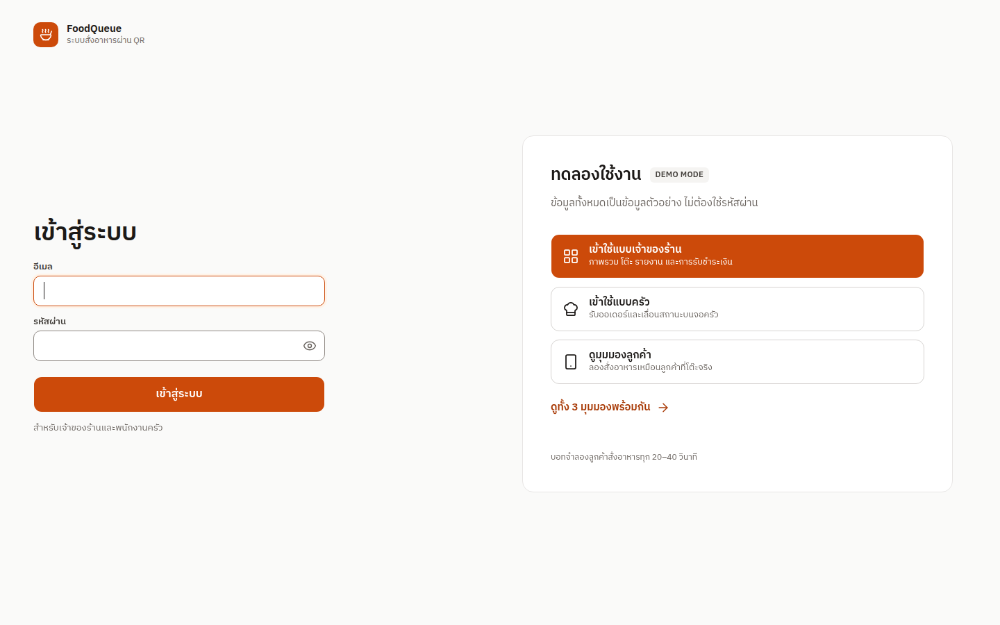

บัญชีพนักงานของ demo (มีเฉพาะเมื่อ Demo Mode เปิด และ seed จากฐานข้อมูลว่าง):

| บทบาท | อีเมล | รหัสผ่าน |
|---|---|---|
| เจ้าของร้าน | `owner@demo.local` | `Demo1234!` |
| ครัว | `kitchen@demo.local` | `Demo1234!` |

ข้อมูลทั้งหมดเป็นข้อมูลสังเคราะห์ ไม่มีร้าน ลูกค้า หรือยอดขายจริง — หน้าจอที่แสดงตัวเลขจะติดป้าย `DEMO DATA` ไว้

---

## การพัฒนา

รันเฉพาะ `db` + `caddy` บน Docker แล้วรัน api/web บนเครื่องเพื่อ hot reload:

```bash
docker compose -f compose.yaml -f compose.dev.yaml up db caddy
```

```bash
# terminal 1 — API (http://localhost:5080)
cd backend/src/FoodQueue.Api && dotnet run

# terminal 2 — web (http://localhost:3000, เข้าผ่าน Caddy :8080)
cd frontend && pnpm install && pnpm dev
```

ต้องมี **.NET 10 SDK**, **Node 24**, **pnpm 12**

### Migration

repo นี้มี migration เดียวชื่อ `Initial` และ**สร้างใหม่**แทนการสะสม migration จนกว่าจะมีข้อมูลจริงที่ต้องรักษา:

```bash
cd backend
dotnet ef migrations remove --project src/FoodQueue.Api --startup-project src/FoodQueue.Api
dotnet ef migrations add Initial --project src/FoodQueue.Api --startup-project src/FoodQueue.Api --output-dir Data/Migrations
```

### Mockup / design

```bash
cd design && node build.mjs          # เรนเดอร์ทุก frame
cd design && node build.mjs c1 o1    # เฉพาะ frame ที่ id ขึ้นต้นด้วย argument
```

ผลลัพธ์อยู่ที่ `design/out/` (ไม่ commit) — ต้องมี Playwright Chromium ในเครื่อง

---

## การทดสอบ

```bash
# seam 1 — backend + Postgres จริง ผ่าน Testcontainers (ต้องมี Docker)
cd backend && dotnet test

# seam 2 — Playwright บน stack ที่รันอยู่ (ต้องรัน docker compose ก่อน)
cd frontend && pnpm exec playwright install chromium && pnpm exec playwright test
```

ชุด Playwright มี project `desktop` และ `mobile` (390×844, touch) — flow หลักเดินครบวงจรผ่าน UI จริง: เจ้าของร้านเปิดโต๊ะ → ถอด QR จากพิกเซล → browser context ใหม่สั่งอาหาร → การ์ดเข้าครัวภายในไม่กี่ร้อยมิลลิวินาที → เลื่อนสถานะ → ชำระเงิน → มือถือลูกค้าเปลี่ยนเป็นหน้าขอบคุณเอง พร้อมวัดคอนทราสต์สีสถานะ (WCAG ≥ 4.5:1), touch target ≥ 44px, ไม่มี horizontal scroll ที่ 390px และ `prefers-reduced-motion`

---

## โครงสร้างโปรเจกต์

```
backend/
  src/FoodQueue.Api/          ASP.NET Core — Features/<Module>/, Data/, Realtime/, Common/
  tests/FoodQueue.Api.Tests/  xUnit + Testcontainers
frontend/
  src/app/(staff)/            หน้าหลังร้าน: /owner/* และ /kitchen
  src/app/s/[token]/          หน้าลูกค้าจาก QR
  src/app/print/              หน้าพิมพ์ 80 มม.: prebill / qr / receipt
  src/app/demo/               หน้าจอ 3 มุมมองพร้อมกัน
  src/lib/                    api client, types, realtime, format
  e2e/                        Playwright specs
design/
  src/frames/                 mockup HTML ต้นแบบ (frame ละหน้าจอ)
  DESIGN.md → design tokens (สี ฟอนต์ ระยะ) ใช้ร่วมกับ globals.css
docs/
  adr/                        บันทึกการตัดสินใจเชิงสถาปัตยกรรม
  screenshots/                ภาพจากระบบจริง (ใช้ใน README นี้)
qr-buffet-ordering/           spec.md (ข้อกำหนด 111 user stories) + plan.md + issues/ (ticket 01–27)
```

---

## เอกสาร

| ไฟล์ | เนื้อหา |
|---|---|
| [`qr-buffet-ordering/spec.md`](qr-buffet-ordering/spec.md) | ข้อกำหนดเชิงพฤติกรรมทั้งหมด (problem, solution, user stories, implementation & testing decisions) |
| [`qr-buffet-ordering/plan.md`](qr-buffet-ordering/plan.md) | แผนงานที่อนุมัติ (สำเนาเหมือนต้นฉบับ) |
| [`qr-buffet-ordering/issues/`](qr-buffet-ordering/issues) | ticket 01–27 พร้อมหลักฐานการตรวจรับ |
| [`PRODUCT.md`](PRODUCT.md) | ผู้ใช้ จุดยืน หลักการผลิตภัณฑ์ |
| [`DESIGN.md`](DESIGN.md) · [`design/BRIEF.md`](design/BRIEF.md) | design system, เหตุผลเบื้องหลังหน้าจอ |
| [`GLOSSARY.md`](GLOSSARY.md) | คำในโดเมน (Table Session, Package, Order, Bill, …) |
| [`docs/adr/`](docs/adr) | ADR: QR ผูกกับ session, single-origin Caddy |
| [`frontend/README.md`](frontend/README.md) | รายละเอียดฝั่ง web (versions, tokens, layout, docker) |

---

## ข้อจำกัดและหมายเหตุ

- **ข้อมูลทั้งหมดเป็นข้อมูลสังเคราะห์** — ร้าน "ชาบูเดโม่", โต๊ะ A1–B6, แพ็กเกจ Silver/Gold/Platinum ไม่มีอยู่จริง
- **รูปเมนู** ใน mockup เป็นภาพประกอบจาก Wikimedia Commons (สัญญาอนุญาตอยู่ใน [`design/src/assets/menu/CREDITS.md`](design/src/assets/menu/CREDITS.md)) ต้องเปลี่ยนเป็นภาพของร้านก่อนใช้งานจริง
- **การพิมพ์** ใช้ print dialog ของเบราว์เซอร์ลงกระดาษความร้อน 80 มม. ไม่มีไดรเวอร์หรือ service พิมพ์แยก
- **ร้านเดียว / ภาษาไทยเท่านั้น** — ไม่มี multi-tenant, multi-currency หรือ i18n
- ระบบออกแบบให้รันในเครื่อง (local) — ก่อนขึ้น production จริงต้องเปลี่ยนรหัสฐานข้อมูล, ตั้ง HTTPS/HSTS, ปิด Demo Mode และจัดการ secrets ให้เรียบร้อย
- repo นี้ไม่มีไฟล์ `LICENSE` — สงวนลิขสิทธิ์โดยผู้เขียน ใช้เป็นผลงานอ้างอิง/พอร์ตโฟลิโอ
